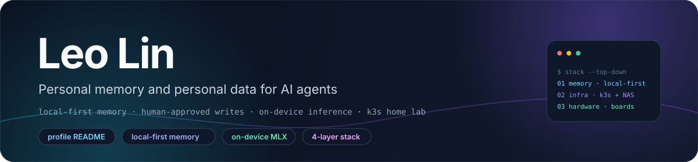
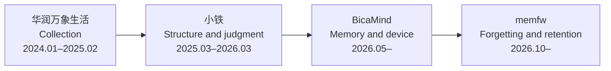
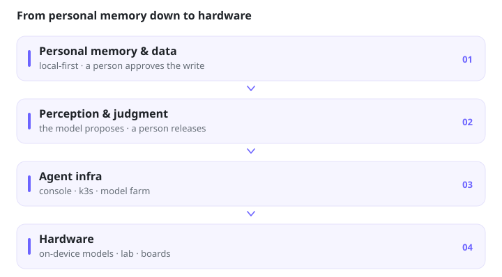
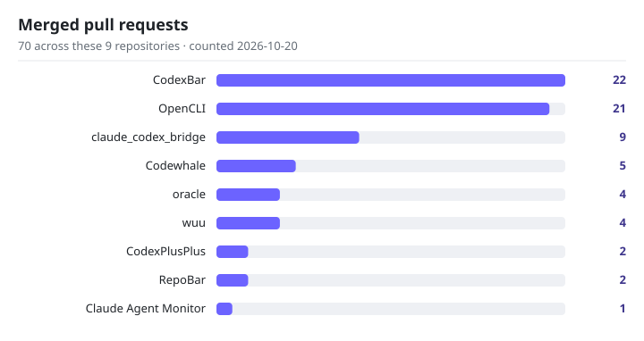

# Leo Lin · 林中玥

**Personal memory and personal data for AI agents, plus the infrastructure and hardware they run on.**

Local-first memory · human-approved writes before model proposals · on-device inference · k3s home lab

[**简体中文**](README.zh-CN.md) · **English**

> [!NOTE]
> **Current state.** This repository is the profile README: the banner in
> [`docs/assets/`](docs/assets), the stack and upstream graphics in [`assets/`](assets), two workflow
> files under [`.github/workflows/`](.github/workflows), and this document. The projects described
> below live in their own repositories; work that is not public is described without a link.

## ✨ About

One line of work: personal memory and personal data for agents, the perception and judgment on top
of it, the agent infrastructure underneath, and the hardware it reaches. The control order is
**human > mechanism > model**.

- **A write is applied by a person.** A model may propose a change; applying it stays a human step.
- **Forgetting is a mechanism, not a model call.** Fixed rules choose what is evicted, and each row
  carries the reason it was chosen.
- **An inference is not the user's voice.** What a model guessed is capped below the bar that would
  let it reach a live turn as the user's own statement.
- **Negative results stay in the record.** Measurements are dated and rerunnable; a result that did
  not clear its bar is reported as such.

## 🧭 The line

Collection, then structuring and judgment, then the memory layer, then the device. The dates are
the periods each stage covered.

| Stage | Where | What |
|---|---|---|
| Collection | 华润万象生活 (Shanghai) | Daily reconciliation and paper receipts enter a pipeline a person can rerun |
| Structure & judgment | 小铁 | Scattered store data into one schema; the model judges, rules and a person release a result |
| Memory & device | BicaMind | Long-term memory for a voice agent, and the hardware it enters through |
| Forgetting & retention | memfw | Fixed rules forget and anchor; a model may propose, a person applies |

Personal memory and data, then perception and judgment, then agent infra, then hardware.

<picture>
  <source media="(prefers-color-scheme: dark)" srcset="./assets/thesis-stack-dark.svg" />
  <source media="(prefers-color-scheme: light)" srcset="./assets/thesis-stack-light.svg" />
  
</picture>

## 🧠 Current work

- **memfw — framework.** A model-agnostic, local-first personal memory framework in Python.
- **memfw — retention.** Five forgetting strategies (`fifo`, `lru`, `decay`, `salience`,
  `consolidate_then_forget`) are pure functions and return a reason per row; human anchors are never
  evicted.
- **memfw — write path.** Markdown is the authority, a hash-chained JSONL log records every state
  change, and SQLite FTS5 is a disposable index. The framework does not call an LLM and does not send
  data out.
- **memfw — local LoCoMo run (2026-10-19).** 10 conversations, 5,882 turns, 1,986 questions, 1,000
  paired bootstrap samples with Holm correction, finished in 249 seconds. No pairwise difference
  between strategies is significant; at a 25% budget salience has the highest point estimate, 14.5%
  against FIFO's 13.0%, and that gap is not significant. On 200 synthetic items, no strategy cleared
  the collection bar.
- **memfw — import pilot.** 656 real memories on local MLX (Qwen2.5-7B 4-bit) stalled: after 6+ hours
  only 498 rows landed, because each save rechecks the whole store. Model proposals are paused, batch
  writes are next. 38.4% of those records have only a file mtime as a timestamp.
- **memfw — checks.** 396 tests and `mypy --strict` passed as of that snapshot.
- **BicaMind.** Long-term memory for a voice agent. Explicit user memory is stored as such, replayed
  at confidence 0.95 and recalled next session; inferences are capped at 0.65, under the 0.7 bar of
  the always-on voice prompt, so they reach a live turn only through prefetch.
- **[sayless](https://github.com/LeoLin990405/sayless).** Local-first dictation, a non-commercial
  learning project: record → whisper.cpp on device (about 1 second for 8 seconds of speech; audio
  stays on the machine) → a deterministic dictionary → LLM polish → paste into the focused app.
  History and the lexicon stay local.
- **Day-to-day agent memory.** Several agents share one Markdown memory on a private NAS
  (user / feedback / project / reference / incident; credentials stay out). Snapshot 2026-10-17:
  about 600 memories, 1,400+ change events, 2,963 commits across several agent identities.
- **Companion-model evaluation.** 150 scenarios (130 test / 20 dev, 17 subtypes) are frozen,
  blind-judged, turned into training data, then checked before and after. Real generations cover 9
  providers: 1,168/1,170 outputs, 660 pairwise judgments. Still open: a synthetic set, a single
  judge, 13 rank reversals, an unfilled human-calibration pack, and a 500-step LoRA run.
- **Flickfic.** A University of Hong Kong student startup initiated by REMi; I am the main engineer.
  Reader behaviour (views, dwell, drop-off) drives regeneration of the weak states. Not linked here.

## 🖥️ Hardware & AI infra

- **On-device models.** MLX, GGUF, and whisper.cpp.
- **Home lab, on Tailscale.** Multi-GPU machines, Mac MLX for local inference, k3s on three Lenovo
  Tiny machines, an Apple Silicon node and a NAS. A model farm swaps models as quota and quality
  change; task state stays in local SQLite.
- **Dev boards.** RK3566, RK3399, RK3568. Raspberry Pi Pico 2 W (ARM and RISC-V). ESP32.

## 🗂️ Projects

| Project | What it is |
|---|---|
| **[agos](https://github.com/LeoLin990405/agos)** | Honesty-first console and memory workbench. Every figure comes from a ledger on disk; a missing probe renders as not collected. Humans keep the decision; models propose. |
| **[civagent](https://github.com/LeoLin990405/civagent)** · ⭐ 41 | An orchestration and governance experiment: 57 historical governance systems compiled into multi-agent patterns, with a constitutional engine (`VETO` / `IMPEACH` / `EDICT`) and a tournament pipeline that tests whether the institution changes the outcome. |
| **[FuguNano](https://github.com/BicaMindLabs/FuguNano)** · ⭐ 28 | Training-free control plane (BicaMind Labs): plan, dispatch, review, repair, learn, with verifier-aware routing and a bounded repair loop. |

## 🧰 Tools

Star counts below are as stated on 2026-10-20.

- **[grimoire-skill](https://github.com/LeoLin990405/grimoire-skill)** · ⭐ 8 — parse a PDF once,
  forge two artifacts: typed reading notes for Obsidian and a reusable skill pack.
- **[oral-interview-transcription-skill](https://github.com/LeoLin990405/oral-interview-transcription-skill)**
  · ⭐ 16 — oral-history recordings → faithful edited transcripts, with an adversarial fidelity gate;
  data stays local.
- **[r-analytics-skill](https://github.com/LeoLin990405/r-analytics-skill)** · ⭐ 5 — 93 package-level
  R skills for Claude Code.
- **[skill-librarian](https://github.com/LeoLin990405/skill-librarian)** · ⭐ 1 — lint and index a
  large local `SKILL.md` library: duplicates, dead links, name collisions, weak descriptions.
- **[paper-reading-workflow-zh](https://github.com/LeoLin990405/paper-reading-workflow-zh)** · ⭐ 1 —
  evidence-grounded Chinese paper-reading workflow (PDF → MinerU → Obsidian).
- **[cn-cc](https://github.com/LeoLin990405/cn-cc)** · ⭐ 1 · **[mmteam-cc](https://github.com/LeoLin990405/mmteam-cc)**
  — route Claude Code work to Chinese model backends; multi-model agent teams with fan-out consensus.
- **[ScreenBar](https://github.com/LeoLin990405/ScreenBar)** — a SwiftUI menu-bar app that turns Macs
  on your tailnet into second screens.

## ⬆️ Upstream contributions

Merged pull requests in other people's repositories, coursework set aside. Counted 2026-10-20:
**70 merged** across the 9 repositories below, **8 still open**. Star counts are exact.

In Peter Steinberger's repositories alone: **[30 merged PRs](https://github.com/steipete/CodexBar/pulls?q=is%3Apr+author%3ALeoLin990405+is%3Amerged)**
(CodexBar 24, oracle 4, RepoBar 2), counted 2026-10-22 — a later snapshot than the table, which
shows CodexBar at 22.

<picture>
  <source media="(prefers-color-scheme: dark)" srcset="./assets/upstream-prs-dark.svg" />
  <source media="(prefers-color-scheme: light)" srcset="./assets/upstream-prs-light.svg" />
  
</picture>

| Repository | ⭐ | Merged |
|---|---|---|
| [steipete/CodexBar](https://github.com/steipete/CodexBar) | 22,677 | 22 |
| [jackwener/OpenCLI](https://github.com/jackwener/OpenCLI) | 30,462 | 21 |
| [SeemSeam/claude_codex_bridge](https://github.com/SeemSeam/claude_codex_bridge) | 3,580 | 9 |
| [codewhale-hq/Codewhale](https://github.com/codewhale-hq/Codewhale) | 41,103 | 5 |
| [steipete/oracle](https://github.com/steipete/oracle) | 4,062 | 4 |
| [blueberrycongee/wuu](https://github.com/blueberrycongee/wuu) | 60 | 4 |
| [BigPizzaV3/CodexPlusPlus](https://github.com/BigPizzaV3/CodexPlusPlus) | 32,404 | 2 |
| [steipete/RepoBar](https://github.com/steipete/RepoBar) | 2,215 | 2 |
| [hoangsonww/Claude-Code-Agent-Monitor](https://github.com/hoangsonww/Claude-Code-Agent-Monitor) | 1,099 | 1 |

Per-PR highlights and the counting rules: [`docs/upstream-contributions.md`](docs/upstream-contributions.md).

## 🧱 Stack

## ✍️ Writing

| Where | What |
|---|---|
| [blog](https://leolin990405.github.io/blog/) | Essays on this work |
| [udacity-masters-ai-projects](https://github.com/LeoLin990405/udacity-masters-ai-projects) | Applied ML coursework |

## 📊 GitHub stats

Cards below are generated by third-party services from the public `LeoLin990405` account; the
numbers move on their own and are not maintained in this repository.

<a href="https://ghfind.com/u/leolin990405?ref=badge">
  <picture>
    <source media="(prefers-color-scheme: dark)" srcset="https://ghfind.com/api/card/mini/leolin990405?lang=en&theme=dark" />
    <source media="(prefers-color-scheme: light)" srcset="https://ghfind.com/api/card/mini/leolin990405?lang=en&theme=light" />
    
  </picture>
</a>

## 🗓️ Recently

- **2026-10** — [sayless](https://github.com/LeoLin990405/sayless) is public; memfw's full LoCoMo run
  is recorded above, negative result included.
- **2026-09** — [agos](https://github.com/LeoLin990405/agos) opened: execution, approvals, and fleet
  state ([#1](https://github.com/LeoLin990405/agos/pull/1)); honest session, chat, and console slices
  ([#2](https://github.com/LeoLin990405/agos/pull/2)).

## 📁 Repository layout

| Path | Contents |
|---|---|
| `README.md`, `README.zh-CN.md` | English and Chinese profile pages |
| `docs/` | The 1200×280 banner and the upstream-contributions deep dive |
| `assets/` | Stack and upstream-PR charts, each in light/dark and EN/ZH variants |
| `.github/workflows/claude-review.yml` | Claude Code Review on pull requests and on `@claude` comments |
| `.github/workflows/snake.yml` | Daily contribution snake, pushed to the `output` branch |

## 📄 License & reuse

> [!WARNING]
> No license file is included in this repository. Nothing here is licensed for reuse; treat the text
> and the graphics as all rights reserved, and ask before copying them elsewhere.

The two workflow files reference third-party actions and credentials that belong to their own
projects: `grll/claude-code-action` and `Platane/snk` with `crazy-max/ghaction-github-pages`. Their
licences govern those actions.

## 🤝 Contact

- GitHub: [@LeoLin990405](https://github.com/LeoLin990405)
- Blog: [leolin990405.github.io/blog](https://leolin990405.github.io/blog/)
- LinkedIn: [Zhongyue Lin](https://www.linkedin.com/in/zhongyue-lin-327143207/)

If one of the projects is useful to you, a star is always appreciated.
