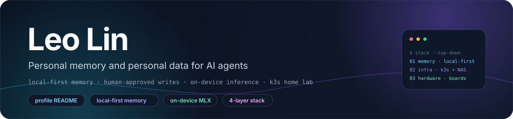
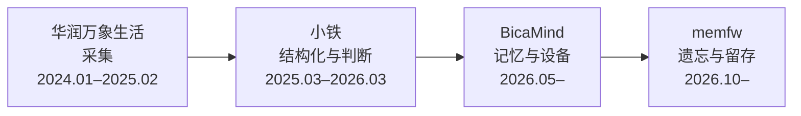
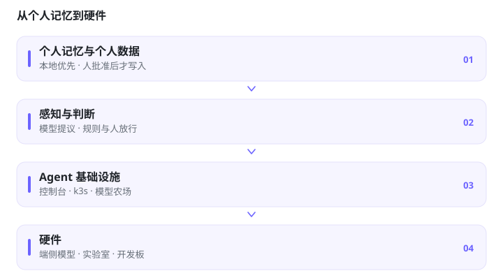
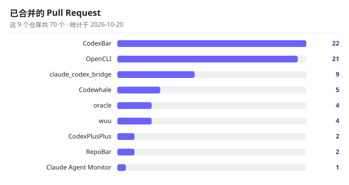

# 林中玥 · Leo Lin

**为 AI Agent 做个人记忆与个人数据，连同它们所依赖的基础设施与硬件。**

本地优先记忆 · 人批准的写入先于模型提议 · 端侧推理 · k3s 家庭实验室

**简体中文** · [**English**](README.md)

> [!NOTE]
> **当前状态。** 本仓库是个人主页 README：[`docs/assets/`](docs/assets) 里的横幅、[`assets/`](assets) 里的栈图与上游 PR 图、[`.github/workflows/`](.github/workflows) 下的两个 workflow，以及这份文档。下面描述的项目都在各自的仓库里；未公开的工作只做文字说明，不给链接。

## ✨ 关于

一条主线：为 Agent 做个人记忆与个人数据，往上是感知与判断，往下是 Agent 基础设施，再往下是它落到的硬件。控制顺序是**人 > 机制 > 模型**。

- **写入由人落地。** 模型可以提议变更，真正应用永远是人的一步。
- **遗忘是机制，不是模型调用。** 淘汰由固定规则决定，每一条都带着被选中的理由。
- **推断不是用户自己的话。** 模型猜出来的内容有置信上限，达不到当着用户说出口的那道线。
- **负结果照实留下。** 数据都带日期且可重跑；没达标的结论就写成没达标。

## 🧭 这条线

采集，然后是结构化与判断，然后是记忆层，最后是设备。时间是各阶段覆盖的区间。

| 阶段 | 所在 | 做什么 |
|---|---|---|
| 采集 | 华润万象生活（上海） | 每日对账与纸质小票进入一条人可以重跑的流程 |
| 结构化与判断 | 小铁 | 分散的门店数据收成一套 schema；模型负责判断，规则与人负责放行 |
| 记忆层与设备入口 | BicaMind | 语音 Agent 的长期记忆，以及它进入的硬件 |
| 遗忘与留存 | memfw | 固定规则负责遗忘与锚定；模型可以提议，人来批准 |

个人记忆与数据，然后是感知与判断，然后是 Agent 基础设施，然后是硬件。

<picture>
  <source media="(prefers-color-scheme: dark)" srcset="./assets/thesis-stack-dark-zh.svg" />
  <source media="(prefers-color-scheme: light)" srcset="./assets/thesis-stack-light-zh.svg" />
  
</picture>

## 🧠 在做的事

- **memfw —— 框架。** 模型无关、本地优先的个人记忆框架（Python）。
- **memfw —— 留存策略。** 五种遗忘策略（`fifo`、`lru`、`decay`、`salience`、`consolidate_then_forget`）都是纯函数，逐条返回理由；人工锚定的记忆不会被淘汰。
- **memfw —— 写入路径。** Markdown 是权威内容，带哈希链的 JSONL 记录每次状态变化，SQLite FTS5 只是可丢弃的索引。框架本身不调用 LLM，也不向外发送数据。
- **memfw —— 本地全量 LoCoMo（2026-10-19）。** 10 段对话、5,882 轮、1,986 题，1,000 次配对 bootstrap 加 Holm 校正，249 秒跑完。策略之间两两比较均无显著差异；25% 预算下显著性策略的点估计最高，14.5% 对 FIFO 的 13.0%，差异不显著。200 条合成数据上，没有策略达到采集门槛。
- **memfw —— 导入试点。** 在 656 份真实记忆上跑本地 MLX（Qwen2.5-7B 4-bit）卡住了：6 小时余只写入 498 条，因为每次保存都要重校验整库。模型提议阶段已暂停，下一步改为批量写入。其中 38.4% 的记录只有文件修改时间可作时间戳。
- **memfw —— 检查。** 该快照下 396 项测试与 `mypy --strict` 通过。
- **BicaMind。** 语音 Agent 的长期记忆。用户显式记忆按显式来源入库，回放置信度 0.95，下次会话可召回；推断的置信度上限 0.65，低于语音常驻 prompt 的 0.7 门槛，只能经预取进入当前轮。
- **[sayless](https://github.com/LeoLin990405/sayless)。** 本地优先的语音听写，非商用的学习项目：录音 → 本机 whisper.cpp（8 秒语音约 1 秒转完，语音不出机器）→ 词语库确定性替换 → LLM 润色 → 粘贴进焦点应用。听写历史和词库都在本地。
- **日常 Agent 记忆。** 几个 Agent 共用一套放在自有 NAS 上的 Markdown 记忆（user / feedback / project / reference / incident；凭据不入库）。2026-10-17 快照：约 600 条记忆、1,400+ 条变更事件、来自多个 Agent 身份的 2,963 次提交。
- **陪伴模型评测。** 150 条场景（130 test / 20 dev，17 个子类）先冻结，再盲评，再变成训练数据，然后做 before/after 回归。真实生成覆盖 9 个 provider：1,168/1,170 条输出，660 条 pairwise 判断。尚未解决：合成测试集、单一 judge、13 处排序反转、人工校准包还空着、LoRA 只跑了 500 步。
- **Flickfic。** 香港大学学生创业项目，由 REMi 发起，我是主力工程师。读者的浏览、停留和流失，用来决定哪一段重新生成。此处不放链接。

## 🖥️ 硬件与 AI 基础设施

- **端侧模型。** MLX、GGUF、whisper.cpp。
- **家庭实验室，Tailscale 组网。** 多 GPU 机器、Mac 上的 MLX 本地推理、三台联想 Tiny 上的 k3s，另有 Apple Silicon 节点和 NAS。模型农场按配额和质量替换模型；任务状态留在本机 SQLite。
- **开发板。** RK3566、RK3399、RK3568。Raspberry Pi Pico 2 W（ARM 与 RISC-V）。ESP32。

## 🗂️ 项目

| 项目 | 是什么 |
|---|---|
| **[agos](https://github.com/LeoLin990405/agos)** | 诚实优先的控制台与记忆工作台。屏幕上的每个数字都来自磁盘账本；没有探针就显示「未采集」。人保留决定权，模型只提议。 |
| **[civagent](https://github.com/LeoLin990405/civagent)** · ⭐ 41 | 编排与治理实验：把 57 套历史治理制度编译成多智能体模式，带宪政引擎（`VETO` / `IMPEACH` / `EDICT`）和锦标赛管线，用来检验制度是否真的改变结果。 |
| **[FuguNano](https://github.com/BicaMindLabs/FuguNano)** · ⭐ 28 | 免训练的控制平面（BicaMind Labs）：规划、分派、审查、修复、学习，按验证器结果路由，修复循环有界。 |

## 🧰 工具

下列 Star 数按 2026-10-20 记录。

- **[grimoire-skill](https://github.com/LeoLin990405/grimoire-skill)** · ⭐ 8 —— 一次解析 PDF，炼出两件器物：落进 Obsidian 的类型化阅读笔记，以及可复用的技能包。
- **[oral-interview-transcription-skill](https://github.com/LeoLin990405/oral-interview-transcription-skill)** · ⭐ 16 —— 口述史录音 → 忠实整理稿，带对抗式忠实度质量门，数据全程本地。
- **[r-analytics-skill](https://github.com/LeoLin990405/r-analytics-skill)** · ⭐ 5 —— 面向 Claude Code 的 93 个 R 包级技能。
- **[skill-librarian](https://github.com/LeoLin990405/skill-librarian)** · ⭐ 1 —— 给大型本地 `SKILL.md` 技能库做体检与索引：重复、死链、重名、弱描述。
- **[paper-reading-workflow-zh](https://github.com/LeoLin990405/paper-reading-workflow-zh)** · ⭐ 1 —— 证据落地的中文论文精读流程（PDF → MinerU → Obsidian）。
- **[cn-cc](https://github.com/LeoLin990405/cn-cc)** · ⭐ 1 · **[mmteam-cc](https://github.com/LeoLin990405/mmteam-cc)** —— 把 Claude Code 任务路由到国产模型后端；多模型 agent 团队与扇出共识。
- **[ScreenBar](https://github.com/LeoLin990405/ScreenBar)** —— SwiftUI 菜单栏应用，把 tailnet 里的 Mac 变成第二块屏幕。

## ⬆️ 上游贡献

合进别人仓库的 pull request，课程作业除外。计数日期 2026-10-20：下表 9 个仓库共 **70 个已合并**，另有 **8 个仍开放**。Star 为精确值。

仅 Peter Steinberger 的仓库：**[30 个已合并 PR](https://github.com/steipete/CodexBar/pulls?q=is%3Apr+author%3ALeoLin990405+is%3Amerged)**（CodexBar 24、oracle 4、RepoBar 2），2026-10-22 统计——比下表晚两天，届时 CodexBar 已是 24 个。

<picture>
  <source media="(prefers-color-scheme: dark)" srcset="./assets/upstream-prs-dark-zh.svg" />
  <source media="(prefers-color-scheme: light)" srcset="./assets/upstream-prs-light-zh.svg" />
  
</picture>

| 仓库 | ⭐ | 合并数 |
|---|---|---|
| [steipete/CodexBar](https://github.com/steipete/CodexBar) | 22,677 | 22 |
| [jackwener/OpenCLI](https://github.com/jackwener/OpenCLI) | 30,462 | 21 |
| [SeemSeam/claude_codex_bridge](https://github.com/SeemSeam/claude_codex_bridge) | 3,580 | 9 |
| [codewhale-hq/Codewhale](https://github.com/codewhale-hq/Codewhale) | 41,103 | 5 |
| [steipete/oracle](https://github.com/steipete/oracle) | 4,062 | 4 |
| [blueberrycongee/wuu](https://github.com/blueberrycongee/wuu) | 60 | 4 |
| [BigPizzaV3/CodexPlusPlus](https://github.com/BigPizzaV3/CodexPlusPlus) | 32,404 | 2 |
| [steipete/RepoBar](https://github.com/steipete/RepoBar) | 2,215 | 2 |
| [hoangsonww/Claude-Code-Agent-Monitor](https://github.com/hoangsonww/Claude-Code-Agent-Monitor) | 1,099 | 1 |

逐 PR 的看点与统计口径见 [`docs/upstream-contributions.md`](docs/upstream-contributions.md)。详细文档（docs/*）当前以英文为主。

## 🧱 技术栈

## ✍️ 写作

| 在哪 | 是什么 |
|---|---|
| [博客](https://leolin990405.github.io/blog/) | 关于这些工作的随笔 |
| [udacity-masters-ai-projects](https://github.com/LeoLin990405/udacity-masters-ai-projects) | 应用 ML 课程作业 |

## 📊 GitHub 数据

下面的卡片由第三方服务根据公开的 `LeoLin990405` 账号生成；数字会自己变，本仓库不维护它们。

<a href="https://ghfind.com/u/leolin990405?ref=badge">
  <picture>
    <source media="(prefers-color-scheme: dark)" srcset="https://ghfind.com/api/card/mini/leolin990405?lang=en&theme=dark" />
    <source media="(prefers-color-scheme: light)" srcset="https://ghfind.com/api/card/mini/leolin990405?lang=en&theme=light" />
    
  </picture>
</a>

## 🗓️ 最近

- **2026-10** —— [sayless](https://github.com/LeoLin990405/sayless) 公开；memfw 的全量 LoCoMo 见上，负结果一并记下。
- **2026-09** —— [agos](https://github.com/LeoLin990405/agos) 公开：执行、审批与机群状态（[#1](https://github.com/LeoLin990405/agos/pull/1)）；会话、聊天与控制台的诚实切片（[#2](https://github.com/LeoLin990405/agos/pull/2)）。

## 📁 仓库结构

| 路径 | 内容 |
|---|---|
| `README.md`、`README.zh-CN.md` | 英文与中文主页 |
| `docs/` | 1200×280 横幅与上游贡献详解 |
| `assets/` | 栈图与上游 PR 图，各有明暗与中英四个版本 |
| `.github/workflows/claude-review.yml` | 在 PR 与 `@claude` 评论上跑 Claude Code Review |
| `.github/workflows/snake.yml` | 每日贡献蛇，产物推到 `output` 分支 |

## 📄 许可证与复用

> [!WARNING]
> 本仓库不包含许可证文件。此处内容未授予任何复用许可：文字与图形按「保留所有权利」对待，转载或复用前请先询问。

两个 workflow 文件引用的第三方 action 与凭据归属各自项目：`grll/claude-code-action`，以及 `Platane/snk` 与 `crazy-max/ghaction-github-pages`。它们的行为受各自许可证约束。

## 🤝 联系

- GitHub: [@LeoLin990405](https://github.com/LeoLin990405)
- 博客: [leolin990405.github.io/blog](https://leolin990405.github.io/blog/)
- LinkedIn: [Zhongyue Lin](https://www.linkedin.com/in/zhongyue-lin-327143207/)

如果哪个项目帮到了你，欢迎点个 star。
