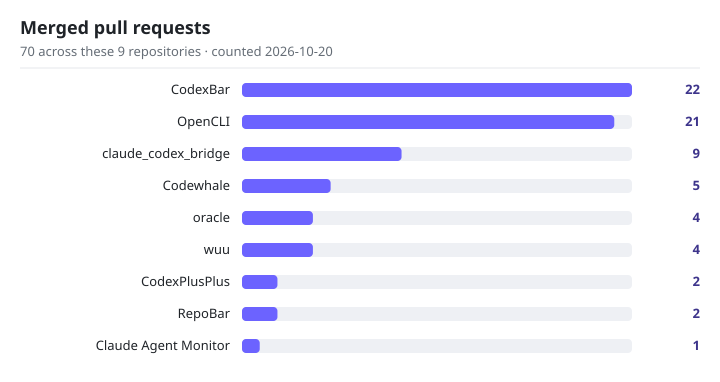

# Upstream contributions — full table

Merged pull requests in other people's repositories, coursework set aside. This page is the long
form of the *Upstream contributions* summary in [`../README.md`](../README.md): the same 9
repositories, the same counts, plus the per-PR highlights that do not fit in the README.

**Counted 2026-10-20:** 70 merged across the 9 repositories below, **8 still open**. Star counts are
exact values as shown on that date.

<picture>
  <source media="(prefers-color-scheme: dark)" srcset="../assets/upstream-prs-dark.svg" />
  <source media="(prefers-color-scheme: light)" srcset="../assets/upstream-prs-light.svg" />
  
</picture>

| Repository | ⭐ | Merged | Highlights |
|---|---|---|---|
| [steipete/CodexBar](https://github.com/steipete/CodexBar) | 22,677 | 22 | LongCat provider ([#1697](https://github.com/steipete/CodexBar/pull/1697)) · empty Personal usage responses retry and keep the last good card ([#3128](https://github.com/steipete/CodexBar/pull/3128)) · live rollouts no longer starve cost updates ([#3314](https://github.com/steipete/CodexBar/pull/3314)) |
| [jackwener/OpenCLI](https://github.com/jackwener/OpenCLI) | 30,462 | 21 | Kimi web adapter, 21 commands ([#1804](https://github.com/jackwener/OpenCLI/pull/1804)) · Xiaohongshu risk-control cooldown retry ([#2207](https://github.com/jackwener/OpenCLI/pull/2207)) · X profile recovery ([#2193](https://github.com/jackwener/OpenCLI/pull/2193)) |
| [SeemSeam/claude_codex_bridge](https://github.com/SeemSeam/claude_codex_bridge) | 3,580 | 9 | Qwen Code CLI provider ([#124](https://github.com/SeemSeam/claude_codex_bridge/pull/124)) · GitHub Copilot CLI provider ([#122](https://github.com/SeemSeam/claude_codex_bridge/pull/122)) |
| [codewhale-hq/Codewhale](https://github.com/codewhale-hq/Codewhale) | 41,103 | 5 | session persists before stall recovery ([#3285](https://github.com/codewhale-hq/Codewhale/pull/3285)) · `@` completion file walk has a wall-clock budget ([#4367](https://github.com/codewhale-hq/Codewhale/pull/4367)) |
| [steipete/oracle](https://github.com/steipete/oracle) | 4,062 | 4 | completion proof for short captures ([#293](https://github.com/steipete/oracle/pull/293)) · hidden-window prompt submission ([#302](https://github.com/steipete/oracle/pull/302)) |
| [blueberrycongee/wuu](https://github.com/blueberrycongee/wuu) | 60 | 4 | background-command ownership ([#195](https://github.com/blueberrycongee/wuu/pull/195)) · stable tool prefix ([#194](https://github.com/blueberrycongee/wuu/pull/194)) |
| [BigPizzaV3/CodexPlusPlus](https://github.com/BigPizzaV3/CodexPlusPlus) | 32,404 | 2 | versioned base URL kept ([#1363](https://github.com/BigPizzaV3/CodexPlusPlus/pull/1363)) · graceful inject fallback ([#1360](https://github.com/BigPizzaV3/CodexPlusPlus/pull/1360)) |
| [steipete/RepoBar](https://github.com/steipete/RepoBar) | 2,215 | 2 | compact badges round to nearest ([#81](https://github.com/steipete/RepoBar/pull/81)) · opt-in release notifications ([#82](https://github.com/steipete/RepoBar/pull/82)) |
| [hoangsonww/Claude-Code-Agent-Monitor](https://github.com/hoangsonww/Claude-Code-Agent-Monitor) | 1,099 | 1 | non-negative subagent durations ([#171](https://github.com/hoangsonww/Claude-Code-Agent-Monitor/pull/171)) |

## Per-maintainer counts

In Peter Steinberger's repositories alone: **[30 merged PRs](https://github.com/steipete/CodexBar/pulls?q=is%3Apr+author%3ALeoLin990405+is%3Amerged)**
(CodexBar 24, oracle 4, RepoBar 2), **counted 2026-10-22** — a later count than the 2026-10-20
table above, which shows CodexBar at 22. The two figures are two dated snapshots, not a
disagreement.

## How to read the counts

- Merged counts cover the 9 repositories in the table and exclude coursework.
- The star column is the upstream repository's star count, not a count of the contribution.
- Only merged pull requests are listed; the 8 open ones are not itemised here.
- The `assets/upstream-prs-*.svg` chart in the repository root is the rendering of the
  2026-10-20 counts and uses the same numbers as the table.
